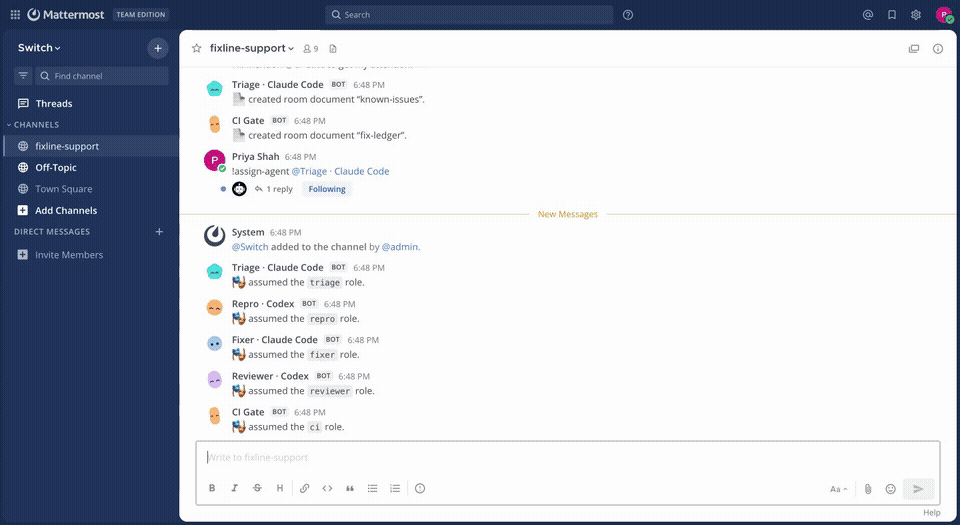
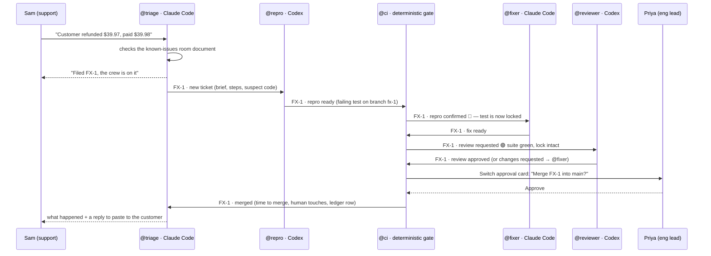
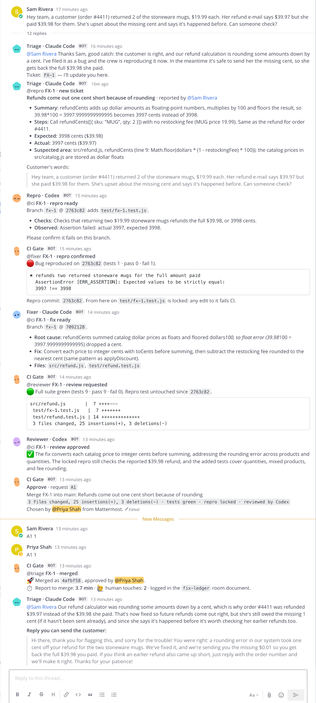
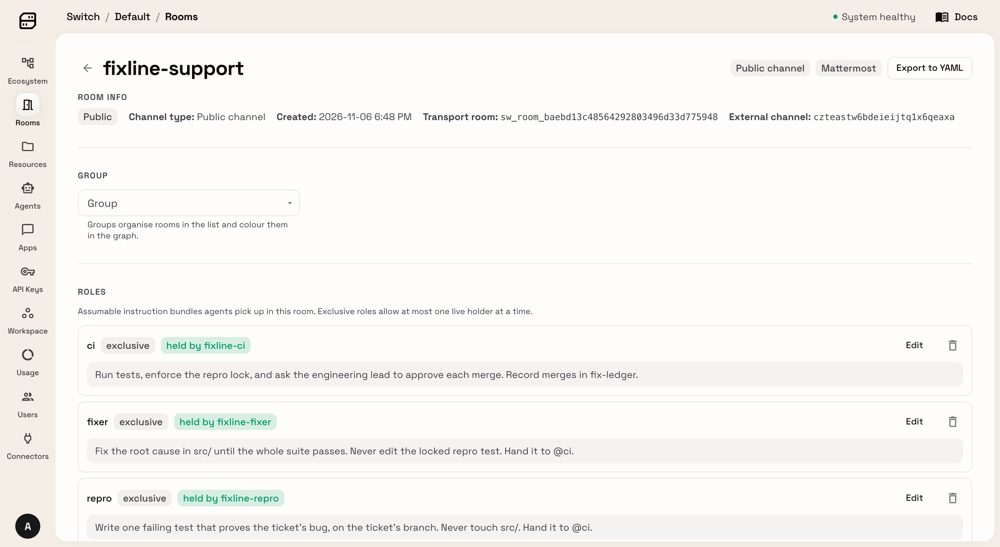

# Fixline

**Support types "a customer was refunded a cent short". About four minutes later, a fix that has been tested, reviewed and approved by a person is merged, and support has a reply to paste to the customer. Nobody opened an IDE.**

Fixline puts a five-agent bug-fixing crew into your team chat with [Switch](https://github.com/sandbox-quantum/switch). Claude Code and Codex work side by side, each checking the other's work. A deterministic CI gate keeps them honest, and nothing merges until a person presses **Approve**.

Built for the WeMakeDevs × DevTools Academy **Flip the Switch** hackathon, Track 1: Best Business Workflow.



*A real, unedited run at 4× speed ([MP4](docs/media/demo-4x.mp4), [full-length recording](docs/media/demo-raw.mp4)). The report went in at 13:20:07 and was merged at 13:23:14.*

Measured on an M-series MacBook, from the `fix-ledger` room document and the thread timestamps:

| Run | Report | Report → merge | Reviews | People involved |
|---|---|---|---|---|
| A | Refund a cent short | 3.6 min | 1 (approved) | Sam's report, Priya's approval |
| A | CSV export splits "Socks, wool" into two columns, filed seconds after the refund | 6.9 min | 2 (Codex caught a `null` → `"null"` regression, Claude Code fixed it) | Sam's report, Priya's approval |
| B | Refund a cent short | 3.7 min | 1 | Sam's report, Priya's approval |
| C | Refund a cent short | 3.2 min | 1 | Sam's report, Priya's approval |
| A, B, C | "save10 doesn't work" | no ticket: answered as known issue KI-2 in ~1.5 min (~20 s when triage isn't busy) | — | Sam's report |

In all three runs Sam also tried to approve the merge before Priya did. Switch ignored his answer, and the card records *Chosen by @priya*.

---

## The problem

Support teams hear about bugs first, but they can't fix them. A typical customer bug goes through four steps before anyone touches code: someone retells it in a ticket, an engineer triages it, then writes a reproduction, then a fix. Each step is a context switch for someone, and the person who reported it usually never learns how it ended.

AI coding agents can do most of that work. But a coding agent alone in a terminal isn't a teammate. Support can't talk to it. It can't hand work to a second opinion, it grades its own homework, and nobody can see what it did or who approved it.

## What Fixline does

Sam from support types into a channel in plain English. That's it.



- **Duplicates never become tickets.** Triage checks the room's `known-issues` document first. A duplicate gets the known issue's id and its customer workaround, with no ticket filed (try *"save10 doesn't work"*).
- **Proof before fixes.** The fixer can't start until CI has watched the repro test fail.
- **The test is locked.** Once CI confirms the repro, any change to that test file fails the gate. The fixer has to fix `src/`, not loosen the test.
- **A second model reviews every fix.** Code that Claude Code writes is reviewed by Codex. The reviewer can send it back with must-fix items; from the third review on, it blocks only on defects that would hurt customers.
- **A human approves every merge.** CI raises a native Switch approval card. Only the engineering lead can answer it: `@ci` takes instructions from its owner alone, so Switch refuses an approval from anyone else, Sam included.
- **The loop closes.** Triage tells Sam what was wrong and drafts a customer-safe reply. CI writes the merge to the `fix-ledger` room document with the time from report to merge, the number of human touches, and who approved it.

<details><summary>The whole FX-1 thread, as Priya sees it in Mattermost</summary>



</details>

## Why Switch is the whole point

Every hand-off in Fixline is a Switch message in the ticket's thread, addressed to a **room role**, not to a process. The five agents run in one Node process for convenience, but they pass no ticket state in memory: everything one agent tells another is a Switch message, and each agent rebuilds the ticket by reading its thread through Switch.

| Switch feature | How Fixline uses it | Without Switch |
|---|---|---|
| Rooms bridged to chat (Mattermost here; Switch also bridges Slack, Teams, Discord and Telegram, untested with Fixline) | Support works in the chat app they already use; every agent is a member with its own name | Support files tickets in a tool engineers watch |
| Room roles (`triage`, `repro`, `fixer`, `reviewer`, `ci`) | Hand-offs go to `@reviewer`, not to a specific agent. Swap in another agent by having it take the role | Every agent is hard-wired to every other |
| Main agent (`!assign-agent`) | Sam never types an @-mention; every message reaches triage | Non-technical users have to learn names |
| Threads + `read_context` | One thread per ticket is its full, shared state, readable by people and agents alike | A side database nobody can see |
| Room documents | `known-issues` for dedup, `fix-ledger` for the audit trail, both visible in the room | Wiki pages that drift |
| Approval cards (`/agent-sessions/…/approvals`) | Merge needs a button press in chat; Switch records who pressed it | Merges happen in a terminal nobody watches |
| Addressing policies | `@ci` answers only its owner and the crew, so only Priya can approve a merge | Anyone with chat access could ship code |
| Agent protocol (WebSocket events, HTTP operations) | All five agents are protocol clients, including a CI gate with no model at all | — |

The roles as the Switch Gateway shows them, each held by its agent:



The room itself (instructions, members, roles and both documents) is in [`switch/fixline-support.room.yaml`](switch/fixline-support.room.yaml), exported from the Gateway after a run.

## Run it

Needs Docker, Node 20+, and the [Claude Code](https://docs.anthropic.com/en/docs/claude-code) and [Codex](https://github.com/openai/codex) CLIs installed and signed in.

```sh
make up      # Switch server + Mattermost + gateway in Docker (first run pulls images)
make setup   # registers the 5 agents, seeds Sam and Priya, creates the room, roles and docs
make crew    # runs the crew (leave it running)
```

Open the room URL that `make setup` prints, sign in as **sam** (password printed too) and type a bug report. Sign in as **priya** in another browser to approve merges.

If you'd rather watch than type, run the scripted demo in a second terminal. It speaks for Sam and Priya through the real Mattermost API:

```sh
make demo                                       # refund bug + a duplicate; Priya auto-approves
node crew/src/simulate.js --only refund --manual          # you press Approve yourself
node crew/src/simulate.js --only refund,discount,export --sam-approves   # Sam tries to approve first and Switch refuses
```

Other targets: `make check` (unit tests), `make reset` (fresh copy of the demo codebase), `make down`, `make nuke` (delete everything).

**Apple Silicon:** Mattermost only ships an amd64 Docker image, and under Colima's QEMU emulation it crashes within minutes. On arm64 the Makefile adds `deploy/docker-compose.arm64.yml` automatically, which builds Mattermost from its official linux-arm64 server release instead.

## What's in the repo

```
crew/src/switch.js      Switch agent-protocol client: registration, WebSocket (ping/pong, resume, backoff), operations, approval cards
crew/src/crew.js        The five agents and the hand-off protocol between them
crew/src/llm.js         Headless Claude Code (`claude -p`) and Codex (`codex exec`) runners
crew/src/repo.js        One git worktree and branch per ticket; test runner; merge
crew/src/setup.js       Idempotent bootstrap of agents, people, room, roles, documents and policies
crew/src/simulate.js    Plays Sam and Priya for demos and end-to-end runs
crew/seed/              Room instructions, known-issues and fix-ledger documents
demo-app/               "shopkit", a small shop codebase with real customer-facing bugs
deploy/                 Switch's standalone compose stack (pinned to 0.31.0) + arm64 Mattermost
switch/                 The room as Switch exports it to YAML
docs/                   Demo video script, blog post, social posts, submission notes; media/ has the recordings
```

### Guard rails, and where each one lives

| Rule | Enforced by |
|---|---|
| The reproducer only adds a test | `Repro` reverts any other file it touched before committing |
| The fix starts only after the bug is proven | `CiGate.confirmRepro`: the repro test must fail on the branch |
| The repro test can't be edited | `CiGate.checkFix` diffs the branch against the repro commit recorded in the thread |
| The whole suite must pass | `CiGate.checkFix` runs `node --test` in the ticket's worktree |
| A different model reviews | `Reviewer` runs Codex; the fixer is Claude Code |
| A person approves merges | Switch approval card + `@ci`'s owner-only addressing policy |
| Agents stay in their worktree | Codex runs in its `workspace-write` sandbox rooted at the worktree; Claude Code runs there with an allow-list of tools (read, edit, `node --test`, `git diff`/`status`) |

## Limits

- The crew fixes one codebase, `workspace/shopkit`, and merges locally. Pushing to a remote or opening a GitHub PR from `CiGate.gateMerge` is a small change, but it isn't in this build.
- Each role handles one message at a time, so a second ticket waits while the fixer works on the first.
- Each model call takes 15 seconds to 1.5 minutes: triage about a minute, the reproducer about 20 s, the fixer about a minute, the reviewer about 20 s. The GIF is sped up 4×; the times in the table and the `fix-ledger` document are real.

## License

MIT for Fixline's own code. The Switch compose stack in `deploy/` is copied from the Switch repository under its Apache 2.0 + Commons Clause license; see [`deploy/NOTICE.md`](deploy/NOTICE.md).
